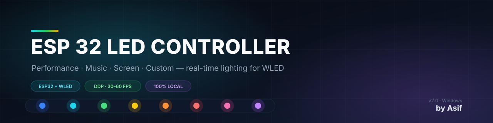

<div align="center">
  
</div>

<h1 align="center">ESP 32 LED Controller</h1>

<p align="center">
  <strong>Real-time lighting for a WLED ESP32 strip that follows your PC — CPU, RAM and GPU load, music, or whatever is on your screen.</strong>
</p>

<p align="center">
  <a href="https://www.python.org/"></a>
  <a href="https://kno.wled.ge/"></a>
  
  <a href="LICENSE"></a>
</p>

---

## About

I built this to make one ESP32 LED strip do everything on my desk: show how
hard the PC is working, react to music, and act as ambient light behind the
monitor. It runs entirely on your own machine — a small Flask dashboard on
`http://localhost:5000` talks to WLED over your LAN, with no cloud service and
no extra hardware.

The strip is driven over **DDP** (UDP 4048) for the live modes, so it updates
at 30–60 fps instead of the one-second crawl you get from HTTP requests.
Custom mode is the exception: it hands the strip back to WLED and lets the
ESP32 animate its own effects.

**By Asif** · Windows 10/11 · WLED 0.16.x · Python 3.10+

## Modes

| Mode | What the strip does |
|---|---|
| **Performance** | Shows CPU, RAM and GPU one at a time, rotating every few seconds. Each metric has its own three-colour ramp (0 %, 50 %, 100 % load). |
| **Music** | Captures system audio through WASAPI loopback (or a microphone), runs an FFT, and drives 12 visual renderers with beat detection and WLED palettes. |
| **Screen** | Mirrors the display using dominant colour, average, vertical bands or edge zones — with white/grey ignored so accent colours stay accurate. |
| **Custom** | Hands control to WLED's own effects, colours and palettes over HTTP, so the ESP32 animates smoothly on its own. |
| **Off** | Fades to black and releases the strip back to WLED. |

## Highlights

- **Three-stop colour ramps.** Every performance metric gets a colour for 0 %,
  50 % and 100 % load. In-between values are blended in **HSV**, not RGB, so
  blue → yellow passes through green instead of grey. Pick the colours in
  **Settings → Performance → Metric colours**; the bars on Home preview them.
- **Accurate screen colours.** Screen mode ignores white, grey and black when
  it looks for the dominant colour, so a green heading on a white page reads
  green rather than washing out to white. Changes are eased in, never snapped.
- **Real music analysis.** Loopback capture, FFT, AGC, silence gate and beat
  detection feed 12 renderers: spectrum, mirror spectrum, bass pulse, VU meter,
  beat pulse, beat flash, beat spectrum, rainbow, mid wave, energy ripple,
  comet and duo tone.
- **Fast output.** DDP streaming at up to 60 fps, with a watchdog that finds
  the ESP32 again after a power cycle or DHCP change.
- **Safe to leave running.** One instance at a time, guarded device access, and
  a crossfade instead of a blink whenever the mode changes.

## Requirements

| | |
|---|---|
| **Controller** | Windows 10 or 11 (WASAPI loopback for music) |
| **Python** | 3.10 or newer (tested on 3.13) |
| **LEDs** | ESP32 running WLED 0.16.x, WS2812B / SK6812 strip |
| **Network** | PC and ESP32 on the same LAN |
| **GPU stats** | NVIDIA GPU with NVML for GPU load; CPU and RAM work on their own |

## Repository structure

```text
ESP-32-LED-Controller/
├── app_v2.py              # current app: modes, control loop, Flask routes
├── app.py                 # original single-mode version (legacy)
├── audio_capture.py       # WASAPI loopback and microphone capture
├── audio_analysis.py      # FFT, AGC, beat detection, spectrum bands
├── music_renderers.py     # 12 music visual effects
├── screen_capture.py      # screen grab, colour extraction, easing
├── system_monitor.py      # CPU / RAM / GPU / temperature stats
├── wled_ddp.py            # DDP transport (UDP 4048)
├── wled_api.py            # WLED HTTP JSON helpers
├── wled_palettes.py       # reads WLED palettes for the music renderers
├── launcher.pyw           # starts the app in the background, opens the dashboard
├── create_shortcut.ps1    # desktop + startup shortcuts for Windows
├── requirements.txt
├── config.example.json    # every setting with its default
├── static/                # v2.js, v2.css, settings.js, custom.js, script.js, style.css
├── templates/             # base.html, home.html, settings.html, custom.html, index.html
├── docs/
│   ├── WLED-SETUP.md      # flashing, Wi-Fi and strip configuration
│   ├── TROUBLESHOOTING.md # device, audio, screen and colour fixes
│   └── archive/           # development notes, kept for reference
├── tests/
│   ├── verify_v2.py       # end-to-end check against a running dashboard
│   └── test_music_behavior.py
├── assets/
│   └── banner.svg
├── .gitattributes         # line endings for Windows scripts
├── .gitignore
├── LICENSE
└── README.md
```

The application modules stay at the repository root on purpose: `app_v2.py`
imports them directly, and `launcher.pyw` expects them next to itself, so a
flat layout keeps the desktop shortcut and `python app_v2.py` working from any
checkout.

## Installation

### 1. Set up WLED

Flash the ESP32, join it to your Wi-Fi and configure the strip. Follow
[docs/WLED-SETUP.md](docs/WLED-SETUP.md) if you are starting from scratch.

### 2. Get the code

```powershell
git clone https://github.com/Asif4517-git/Esp-32-led-controller.git
cd Esp-32-led-controller
```

### 3. Install the dependencies

```powershell
py -m venv .venv
.venv\Scripts\activate
pip install -r requirements.txt
```

### 4. Run it

```powershell
python app_v2.py
```

Then open <http://localhost:5000>. The process keeps running in that terminal;
`Ctrl + C` stops it.

For everyday use, start it with no console window:

```powershell
pythonw launcher.pyw
```

Or create desktop and startup shortcuts once:

```powershell
powershell -ExecutionPolicy Bypass -File create_shortcut.ps1
```

The desktop shortcut starts the app, lights the strip and opens the dashboard.
The startup shortcut lights the strip at login without opening a browser.

## Using the dashboard

### Home

- **Power** turns the strip on and off with a fade.
- **Mode cards** switch between Performance, Music, Screen and Custom.
- **Live panels** show CPU, RAM, GPU and memory, plus the colour the strip is
  currently showing.
- **Mode options** under the cards change the settings for the selected mode —
  rotation time, renderer, screen mapping, custom colour and effects. The
  Performance panel also previews all three colour ramps and links straight to
  the editor.

### Settings

| Tab | What is there |
|---|---|
| **Device** | ESP32 IP, LED count, connection test, device info |
| **Performance** | Rotation time, high-usage warning, metric colour ramps, output brightness |
| **Music** | Source, input device, renderer, palette, frame rate, sensitivity |
| **Screen** | Mapping style, monitor, frame rate, capture status |
| **About** | Version and project credits |

The settings page saves as you change things; there is no Apply button.

## Performance colour ramps in detail

Each of CPU, RAM and GPU has three colours: **0 %**, **50 %** and **100 %**.
For a ramp `A → B → C`:

- 0–50 % load blends `A` toward `B`
- 50–100 % load blends `B` toward `C`
- the blend happens in HSV, taking the shortest hue path

With blue at 0 %, yellow at 50 % and red at 100 %:

| Load | Colour |
|---|---|
| 0 % | blue `(0, 0, 255)` |
| 10 % | `(0, 153, 255)` |
| 25 % | green `(0, 255, 128)` |
| 50 % | yellow `(255, 255, 0)` |
| 75 % | orange `(255, 128, 0)` |
| 100 % | red `(255, 0, 0)` |

At or above the high-usage warning the strip turns solid red. With **Dim
brightness with load** off, the picked colour is shown exactly; turn it on to
also scale brightness between the minimum and maximum sliders.

## Configuration

On first run the app creates `config.json` next to `app_v2.py` and keeps it in
sync with the settings page. It is ignored by git; `config.example.json` shows
every key with its default value.

| Key | Default | Meaning |
|---|---|---|
| `esp32_ip` | `wled.local` | Address of the WLED device |
| `led_count` | `8` | Number of LEDs on the strip |
| `perf_test_cycle_time` | `5.0` | Seconds each metric is shown |
| `high_usage_threshold` | `90` | Load percentage that forces solid red |
| `perf_cpu_colors` / `perf_ram_colors` / `perf_gpu_colors` | green → red / blues / purples | Three RGB stops per metric |
| `music_renderer` | `spectrum` | Music visual effect |
| `music_source` | `system` | `system` loopback or microphone |
| `music_fps` | `60` | Music frame rate |
| `music_sensitivity` | `1.6` | Input gain |
| `screen_mode` | `dominant` | `dominant`, `average`, `bands` or `edges` |
| `screen_monitor` | `1` | Monitor number (1-based) |
| `screen_fps` | `30` | Target capture rate |

Deleting `config.json` and restarting restores every default.

## Tests

With the dashboard running:

```powershell
python tests/verify_v2.py
```

The script exercises the routes and mode switches over HTTP and prints a
pass/fail summary. `tests/test_music_behavior.py` plays a test tone and checks
that the strip lights up with sound and goes dark in silence.

## Troubleshooting

- [WLED setup and reconnecting the board](docs/WLED-SETUP.md)
- [Device offline, wrong colours, no audio, screen issues](docs/TROUBLESHOOTING.md)
- Application logs: `controller.log`, `controller_console.log`

## License

MIT — see [LICENSE](LICENSE).

**Made by Asif**
